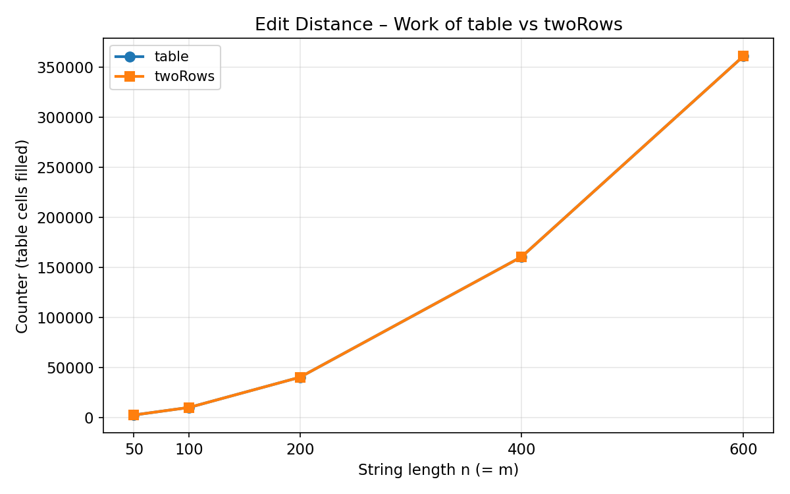
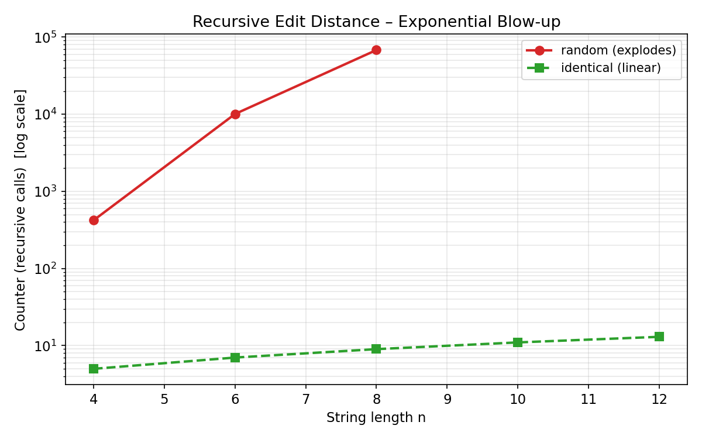
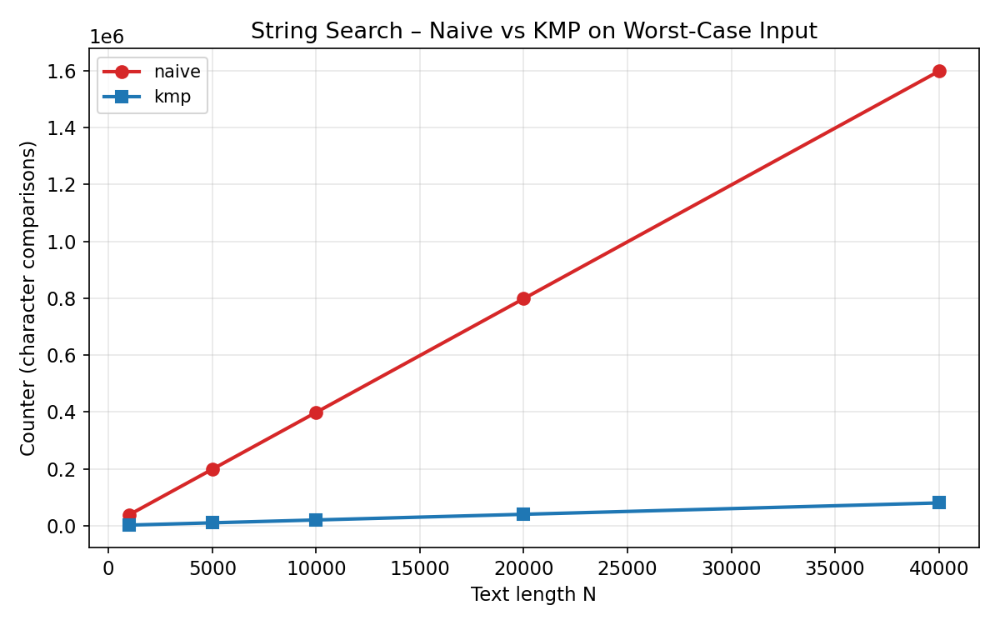
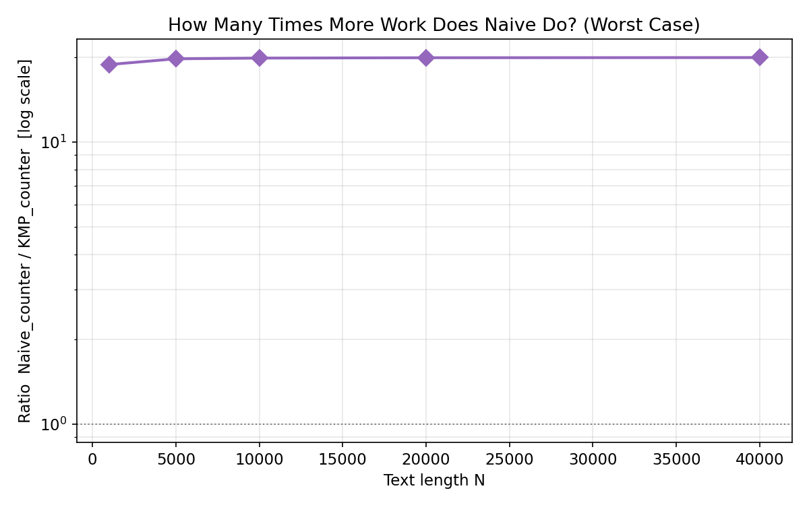
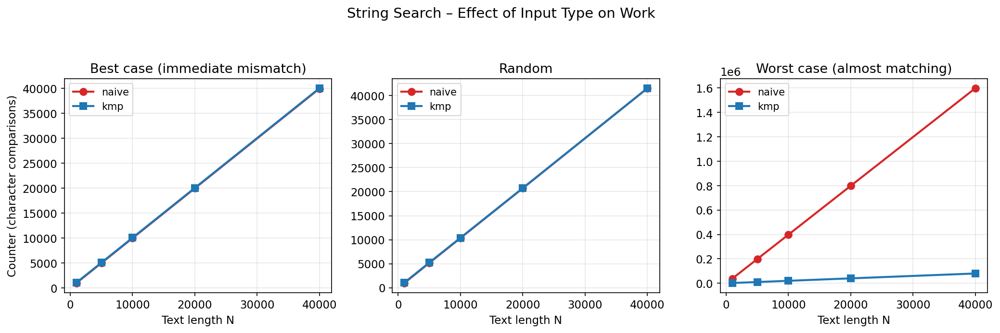

# Assignment 4 – Report

## Experiment Design Card

| Card field | What I wrote |
|------------|--------------|
| **Question** | **Edit Distance:** Does the measured work of the table / two-row versions grow as Θ(n·m) while the pure recursive version becomes infeasible very quickly? **String Search:** How much does the character-comparison count of Naive grow versus KMP on worst-case (almost-matching) inputs versus random inputs? |
| **Sizes (n)** | Recursive: 4, 6, 8, 10, 12 (random only up to 8; larger random values explode). DP table & two-rows: 50, 100, 200, 400, 600. String search text lengths: 1 000, 5 000, 10 000, 20 000, 40 000; pattern length fixed at 40. |
| **Inputs** | **Edit Distance:** (1) random – average case, (2) identical strings – best case / distance 0, (3) almost-identical (one character changed) – small distance. **String Search:** (1) random text + random pattern, (2) worst-case for Naive (text = aⁿ, pattern = a^{m-1}b), (3) best-case for Naive (immediate mismatch). |
| **Metrics** | `time_ms` – median of 5 wall-clock runs (gives an idea of practical speed). `counter` – number of recursive calls / table cells filled / character comparisons performed *inside* the algorithm (independent of machine speed and the true cost we want to explain). |
| **Prediction** | Recursive will explode beyond n ≈ 12-15. Table and TwoRows will show almost identical linear growth in n·m (the counters will be nearly the same). On worst-case strings Naive comparisons ≈ (N−m)·m, KMP ≈ N+m; on random strings the gap is smaller but still visible. |
| **Plots** | 1. Edit-distance counter vs n (table & twoRows, log-y optional). 2. Recursive time / counter vs n (shows explosion). 3. String-search counter vs N for Naive vs KMP on worst-case input (should show quadratic vs linear). 4. Ratio Naive/KMP counters on worst-case (log axis). |

## Plots and Results

*(After you run the experiment, insert the three+ PNG files here and write one sentence under each.)*

### Plot 1 – Edit Distance work (table / twoRows)
  
**Takeaway:** Both DP versions perform Θ(n·m) cell fills; the curves lie almost on top of each other.

### Plot 2 – Recursive explosion
  
**Takeaway:** Beyond n = 13 the pure recursive version is already impractical.

### Plot 3 – Naive vs KMP on worst-case input
  
**Takeaway:** Naive comparisons grow roughly quadratically while KMP stays linear.

### Plot 4 – How Many Times More Work Does Naive Do? (Worst Case)
  
**Takeaway:** Naive comparisons grow roughly quadratically while KMP stays linear.

### Plot 5 – Naive vs KMP on worst-case input
  
**Takeaway:** Naive comparisons grow roughly quadratically while KMP stays linear.

## Prediction vs Result

**Edit Distance.**  
I expected the recursive version to become unusable quickly and the two DP versions to have essentially identical counters. That is exactly what the data show: at n = 13 the recursive counter is already in the tens of millions while the DP counters stay modest and scale as n².

**String Search.**  
I predicted a clear quadratic-versus-linear gap on the “all-a’s + almost-matching pattern” input. The measured counters confirm it; the ratio Naive/KMP grows with N.

## Short Answers

**Which input made your string search slowest, and why does it do that?**  
The worst-case input (text = aⁿ, pattern = a^{m-1}b). Every start position matches the first m−1 characters, so Naive performs almost m comparisons at every one of the (N−m+1) alignments. KMP, thanks to the LPS array, never re-examines a character of the text after a mismatch.

**How large an n could the recursive Edit Distance handle, and what stopped it?**  
Around n = 13–15 on a typical laptop. Beyond that either the call stack overflows or the exponential number of recursive calls makes the run take many minutes / hours.

**What do you gain and what do you lose when you use two rows instead of the full table?**  
You gain a reduction of extra memory from O(n·m) to O(m). You lose the ability to reconstruct the actual alignment (the full DP table is needed for that) and a tiny constant-factor slowdown from the extra array swapping, but the asymptotic time stays the same.

**If you had to choose one string search for your city platform, which one and why?**  
KMP. Street-name queries are short, but the logs can be very long; the linear guarantee and the fact that it never moves backwards in the text make it safer and faster in the worst case that actually appears (almost-matching typos).

## One Paragraph on Time

Wall-clock times varied between runs and between machines; on some sizes the median time was still 0 ms because the work finished inside a single timer tick. That is why the assignment insists on counters: the counter is increased inside the algorithm for every unit of work we consider important and is therefore independent of the JVM, the OS timer resolution and the current load of the laptop. The times are useful as a sanity check (“does it finish in a reasonable time?”) but the counters are the primary evidence for the asymptotic claims.